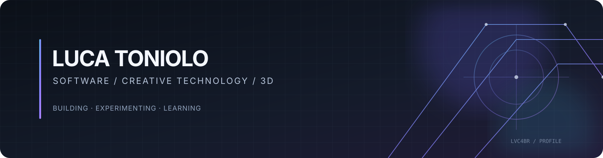

# Luca Toniolo

**Software Development · Creative Technology · 3D**

Conecto desenvolvimento de software, tecnologia criativa e produção 3D. Sou estudante de Técnico em Desenvolvimento de Sistemas na Etec de Itaquera e desenvolvo aplicações web, ferramentas, protótipos e experiências visuais enquanto amplio minha prática com programação, automação e criação digital. Busco uma oportunidade de estágio em desenvolvimento de software ou TI, compatível com minha formação técnica.

*Systems development student building with Python, React and AI, with a 3D production background. Looking for an internship in software development or IT.*

**São Paulo, SP, Brasil** · Técnico em Desenvolvimento de Sistemas — Etec de Itaquera.

---

## Sobre

Meu foco está na interseção entre **software, tecnologia criativa e experiências visuais**. Desenvolvo aplicações web, APIs, ferramentas e protótipos; em paralelo, estudo Blender, modelagem 3D e automação com Python.

Valorizo código compreensível, documentação reproduzível e comunicação honesta sobre o estado de cada projeto. Diferencio funcionalidades implementadas, experimentos e itens planejados — sem apresentar protótipos como produtos prontos.

## Como uso IA

Uso IA como apoio em desenvolvimento, documentação e texturização 3D. Reviso e testo o que incorporo aos projetos.

## Áreas de interesse

| Software Development | Creative Technology |
|---|---|
| Desenvolvimento web e interfaces | Modelagem e visualização 3D |
| JavaScript, React e APIs | Blender e scripting com Python |
| Estruturação, testes e integração | Technical Art e automação criativa |

## Projetos em destaque

### 01 · [LV Portfolio — 3D × Code](https://github.com/Lvc4br/LV_Portfolio)
Portfólio web que reúne trabalhos de desenvolvimento, programação, design e criação 3D.

- **Stack:** React, Vite, JavaScript e CSS.
- **Engenharia:** navegação por rotas, catálogo orientado a dados, componentes reutilizáveis e integrações de analytics configuráveis.
- **Qualidade:** testes automatizados, lint, build e integração contínua.
- **Demonstração:** [luca-toniolo.vercel.app](https://luca-toniolo.vercel.app/).
- **Pipeline:** 

### 02 · [Java Lab](https://github.com/Lvc4br/Java-Lab)
Biblioteca web para consultar, editar e executar cópias de exercícios Java.

- **Stack:** JavaScript, HTML e CSS; Node.js nas ferramentas de desenvolvimento.
- **Engenharia:** catálogo gerado, editor no navegador, separação entre edição e execução e integração com Judge0 CE.
- **Qualidade:** testes automatizados e CI.
- **Limite atual:** a execução depende de um serviço externo; não há terminal interativo nem persistência de submissões. O código editado não altera os exercícios originais.
- **Pipeline:** 

### 03 · [Nexo Analytics](https://github.com/Lvc4br/nexo-analytics)
Projeto de telemetria para aplicações web, reunindo dashboard, API e SDK de coleta de eventos.

- **Stack:** React, Vite, Python, FastAPI e JavaScript.
- **Engenharia:** ingestão e validação de eventos, API, painel administrativo e documentação de dados e privacidade.
- **Estado:** em evolução. A implantação de produção depende de armazenamento persistente, configuração segura e validação operacional no ambiente publicado.
- **Pipeline:** 

### 04 · [Technical Art Toolkit](https://github.com/Lvc4br/Lvc4br/tree/main/Technical-Art-Toolkit)
Add-on experimental em Python para apoiar tarefas repetitivas dentro do Blender.

- **Implementado:** validação de cenas, renomeação de objetos selecionados e geração procedural com parâmetros reproduzíveis por seed.
- **Engenharia:** separação entre interface, operadores e lógica procedural usando a API bpy.
- **Estado:** versão documentada 0.2, em desenvolvimento. A compilação Python não substitui testes dentro do Blender; compatibilidade com todas as versões não está garantida.
- **Documentação:** [README e instruções de instalação](Technical-Art-Toolkit/README.md).

## Outros projetos e estudos

| Repositório | Foco |
|---|---|
| [MouseTarget](https://github.com/Lvc4br/MouseTarget) | Experimento de interações com ponteiro, JavaScript e CSS. |
| [Projetos PW — ETEC](https://github.com/Lvc4br/Projetos-PW-ETEC) | Atividades acadêmicas e colaborativas de Programação Web. |
| [MicroSoftLearn](https://github.com/Lvc4br/MicroSoftLearn) | Estudos de C# em aplicação de console .NET. |
| [ETEC — Desenvolvimento de Sistemas](https://github.com/Lvc4br/ETEC-Desenvolvimento-de-Sistemas) | Exercícios e estudos da formação técnica. |
| [NSA 2.0](https://github.com/Lvc4br/NSA-teste) | Protótipo de interface de portal acadêmico com dados simulados. |
| [Aprendizado Escolar 2025](https://github.com/Lvc4br/Aprendizado-Escolar-2025) | Projeto acadêmico de interface web estática. |
| [Game da Tabuada](https://github.com/Lvc4br/Game-da-Tabuada) | Jogo educativo de multiplicação com HTML, CSS, JavaScript e recorde salvo no navegador. |

### Arquivos e experimentos anteriores
- [Web Portfolio 2025](https://github.com/Lvc4br/Web-Portfolio-2025) e [webpage](https://github.com/Lvc4br/webpage) — versões e experimentos anteriores preservados como histórico.
- [Biblioteca Blender](https://github.com/Lvc4br/Biblioteca-Blender) — repositório privado destinado à organização de arquivos e recursos 3D.
- [mobile](https://github.com/Lvc4br/mobile) — notas e experimentos iniciais com desenvolvimento mobile.

## Tecnologias e ferramentas

**Desenvolvimento:** Python, JavaScript, HTML, CSS, React, Vite, Java e C#.

**APIs e dados:** FastAPI, REST e SQL.

**Ferramentas:** Git, GitHub, Node.js, npm e VS Code.

**IA e automação:** uso de IA em fluxos de desenvolvimento, documentação e criação 3D; scripts em Python.

**3D e criação:** Blender, modelagem, materiais, iluminação, animação e renderização.

As tecnologias representam ferramentas utilizadas ou estudadas em diferentes projetos e níveis de experiência; esta lista não implica domínio avançado de todas elas.

## Formação

- **Técnico em Desenvolvimento de Sistemas — Etec de Itaquera:** em andamento.
- **Ensino Médio:** concluído.
- **Idiomas:** português (nativo), inglês (B2) e italiano (A2).

## Encontre meu trabalho

- [Portfólio](https://luca-toniolo.vercel.app/)
- [LinkedIn](https://linkedin.com/in/luca-toniolo)
- [ArtStation](https://www.artstation.com/lvc4br)
- [Behance](https://www.behance.net/Toniolo_Luca)
- [The Rookies](https://therookies.co/u/Lvc4br)

---

*Engineering with precision. Creating with purpose.*

