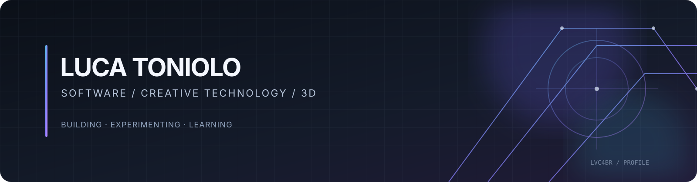

# Luca Toniolo

**Software Development · Creative Technology · 3D**

Estudante de Técnico em Desenvolvimento de Sistemas na Etec de Itaquera. Desenvolvo aplicações, ferramentas e experiências digitais, unindo engenharia de software, automação, interfaces e criação 3D.

Tenho interesse em oportunidades de estágio e início de carreira em **Desenvolvimento de Software, Engenharia de Software e TI**. Gosto de transformar ideias em projetos concretos, com atenção à arquitetura, qualidade, usabilidade e documentação.

Systems Development student focused on software engineering, automation, web technologies and creative 3D workflows.

**São Paulo, SP, Brasil** · Técnico em Desenvolvimento de Sistemas — Etec de Itaquera

---

## Sobre mim

Minha trajetória combina três áreas que se complementam:

- **Desenvolvimento de software:** aplicações web, APIs, ferramentas, integração entre serviços e automação.
- **Engenharia e qualidade:** arquitetura modular, documentação técnica, testes automatizados, integração contínua e atenção à segurança e manutenção.
- **Tecnologia criativa e 3D:** Blender, modelagem, visualização, materiais, iluminação, renderização e scripts para otimizar fluxos de trabalho.

Procuro construir soluções úteis e apresentar cada projeto com transparência sobre seu escopo e estágio de desenvolvimento. Valorizo código legível, decisões técnicas justificadas, testes reproduzíveis e aprendizado contínuo.

## Portfólio

### [Luca Toniolo — 3D × Code](https://lvc4br.github.io/LV_Portfolio/)

Meu portfólio reúne projetos selecionados de **Software Development** e **Creative Technology**, conectando programação, design, experiências web e produção 3D. A publicação no GitHub Pages está em configuração; enquanto isso, consulte o repositório para acompanhar o projeto.

- **Stack:** React 19, Vite 8, JavaScript e CSS.
- **Experiência:** navegação por rotas, páginas de projetos, galerias 3D e de código, temas e componentes reutilizáveis.
- **Engenharia:** catálogo orientado a dados, testes automatizados, ESLint, build e GitHub Actions.
- **Publicação:** GitHub Pages; arquitetura preparada para futura hospedagem principal na Oracle Cloud.
- **Repositório:** [Lvc4br/LV_Portfolio](https://github.com/Lvc4br/LV_Portfolio).

---

## Projetos em destaque

### 01 · [Universal CI/CD](https://github.com/Lvc4br/Especifica-o-Universal-CI-CD-)

Orquestrador modular de CI/CD desenvolvido para detectar projetos, planejar etapas e executar pipelines de diferentes ecossistemas.

- **Tecnologia central:** PowerShell 7.2+.
- **Ecossistemas:** adaptadores para Python, JavaScript/TypeScript, Go, Rust, C#/.NET, Java e outras linguagens.
- **Recursos:** detecção, planejamento, execução com aprovação, timeout e relatórios JSON.
- **Estado:** versão de desenvolvimento; há limitações e recursos ainda pendentes. Não indicado para produção neste estágio.
- **Licença:** MIT.

### 02 · [SFI — Sistema Financeiro Inteligente](https://github.com/Lvc4br/SFI)

Plataforma em desenvolvimento para educação financeira, gestão pessoal, planejamento de consumo e organização patrimonial.

- **Stack planejada:** React, TypeScript, Tauri, React Native, Expo, Python, FastAPI e PostgreSQL (Neon).
- **Arquitetura:** aplicações Web/Desktop/Mobile e backend centralizado.
- **Estado:** núcleo financeiro em evolução; ainda não pronto para produção. Consulte o README e o roadmap para o estado detalhado.

### 03 · [Nexo Analytics](https://github.com/Lvc4br/nexo-analytics)

Projeto de telemetria para aplicações web, reunindo dashboard, API e SDK de coleta de eventos.

- **Stack:** React, Vite, Python, FastAPI e JavaScript.
- **Foco:** ingestão e validação de eventos, API e painel administrativo.
- **Estado:** em evolução; implantação de produção depende de armazenamento persistente, configuração segura e validação operacional.
- **CI:** 

### 04 · [Java Lab](https://github.com/Lvc4br/Java-Lab)

Biblioteca web para consultar, editar e executar cópias de exercícios Java.

- **Stack:** JavaScript, HTML e CSS; Node.js nas ferramentas de desenvolvimento.
- **Recursos:** catálogo de exercícios, editor no navegador e integração com Judge0 CE.
- **Limites:** execução depende de serviço externo; não há terminal interativo nem persistência de submissões.
- **CI:** 

---

## Outros projetos e estudos

| Projeto | Descrição |
|---|---|
| [Game da Tabuada](https://github.com/Lvc4br/Game-da-Tabuada) | Jogo educativo de multiplicação com HTML, CSS e JavaScript. |
| [MouseTarget](https://github.com/Lvc4br/MouseTarget) | Experimentos de interação com ponteiro, JavaScript e CSS. |
| [Projetos PW — ETEC](https://github.com/Lvc4br/Projetos-PW-ETEC) | Atividades acadêmicas e colaborativas de Programação Web. |
| [ETEC — Desenvolvimento de Sistemas](https://github.com/Lvc4br/ETEC-Desenvolvimento-de-Sistemas) | Exercícios e estudos da formação técnica. |
| [MicroSoftLearn](https://github.com/Lvc4br/MicroSoftLearn) | Estudos de C# e aplicações de console .NET. |
| [NSA 2.0](https://github.com/Lvc4br/NSA-teste) | Protótipo de interface de portal acadêmico com dados simulados. |
| [Aprendizado Escolar 2025](https://github.com/Lvc4br/Aprendizado-Escolar-2025) | Projeto acadêmico de interface web estática. |

### Organização acadêmica

Também participo da **[Lab-Tecnico-Etec](https://github.com/Lab-Tecnico-Etec)**, organização voltada à centralização e apresentação de projetos de TCC da Etec.

- **Organização:** [github.com/Lab-Tecnico-Etec](https://github.com/Lab-Tecnico-Etec)
- **Repositório central:** [lab-central](https://github.com/Lab-Tecnico-Etec/lab-central)

---

## Tecnologias e ferramentas

**Linguagens:** Python, JavaScript, TypeScript, Java, C#, C++ e SQL.

**Web e interfaces:** HTML, CSS, React, Vite e React Native.

**Backend e dados:** FastAPI, APIs REST, PostgreSQL e SQLite.

**Automação e qualidade:** PowerShell, Git, GitHub Actions, testes automatizados, lint e CI/CD.

**Ferramentas:** Node.js, npm, VS Code e Blender.

**Criação 3D:** modelagem, materiais, iluminação, animação e renderização.

> As tecnologias representam ferramentas utilizadas ou estudadas em diferentes projetos e níveis de experiência. A presença de uma tecnologia nesta lista não significa domínio avançado ou experiência profissional com ela.

## Formação

- **Técnico em Desenvolvimento de Sistemas — Etec de Itaquera:** em andamento.
- **Ensino Médio:** concluído.
- **Idiomas:** português (nativo), inglês (B2) e italiano (A2).

## Contato

- [Portfólio — 3D × Code](https://lvc4br.github.io/LV_Portfolio/)
- [LinkedIn](https://linkedin.com/in/luca-toniolo)
- [ArtStation](https://www.artstation.com/lvc4br)
- [Behance](https://www.behance.net/Toniolo_Luca)
- [The Rookies](https://therookies.co/u/Lvc4br)

---

*Engineering with precision. Creating with purpose.*

