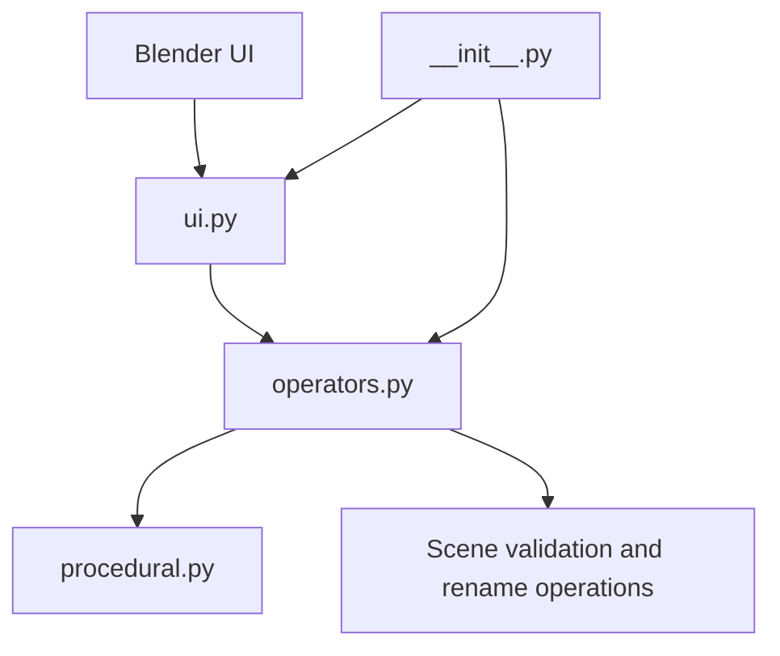

# Technical Art Toolkit — Blender + Python

Add-on experimental para automatizar tarefas repetitivas e validar cenas dentro do Blender. O projeto conecta scripting Python a ferramentas acessíveis pela interface do artista.

## Funcionalidades implementadas

- **Validação de cena:** identifica problemas comuns de nomenclatura, malhas vazias, malhas sem material e escala não aplicada.
- **Renomeação:** aplica prefixo e numeração aos objetos selecionados.
- **Variações procedurais:** gera geometria/objetos com parâmetros de quantidade, semente e espaçamento; a mesma semente permite repetir a sequência.

Os relatórios são apresentados na interface do Blender e/ou no console. A validação ajuda a detectar problemas conhecidos, mas não certifica que uma cena esteja pronta para produção.

## Arquitetura

## Arquitetura



```text
Technical-Art-Toolkit/
├── README.md
├── blender_addon/
│   └── lvc4br_ta_toolkit/
│       ├── __init__.py    # registro do add-on
│       ├── operators.py   # ações disparadas pela interface
│       ├── procedural.py  # lógica de geração
│       ├── ui.py          # painel e controles
│       └── examples/
│           └── README.md
└── examples/
```

A extensão usa a API interna `bpy` do Blender e não requer bibliotecas Python externas conforme a configuração documentada.

## Instalação

1. Baixe ou clone o repositório.
2. No Blender, abra **Edit → Preferences → Add-ons**.
3. Selecione **Install...** e escolha o pacote/pasta do add-on `lvc4br_ta_toolkit`.
4. Ative **Lvc4br Technical Art Toolkit**.
5. No 3D Viewport, pressione `N` e abra a aba **TA Toolkit**.

O README original declara alvo Blender 3.0 ou superior. Verifique a versão utilizada no seu ambiente; compatibilidade com todas as versões não é garantida sem testes específicos.

## Fluxo de exemplo

1. Crie ou importe objetos de teste.
2. Execute **Validate Scene** e examine o relatório.
3. Selecione objetos e use **Rename Selected**.
4. Configure quantidade, seed e espaçamento em **Procedural Tools**.
5. Gere variações e repita com outra seed.

Passo a passo: [examples/README.md](blender_addon/lvc4br_ta_toolkit/examples/README.md).

## Estado e limitações

**Versão documentada: v0.2 — em desenvolvimento.** O add-on demonstra três utilitários; não é uma suíte completa de produção. Ferramentas de coleções/cenas, materiais, preparação de exportação, relatórios avançados e cenas de demonstração permanecem como roadmap, não funcionalidades entregues.

Não há, neste README, alegação de cobertura automatizada de testes ou compatibilidade verificada em todas as versões do Blender.

**Autor:** Luca Toniolo — [@Lvc4br](https://github.com/Lvc4br)
